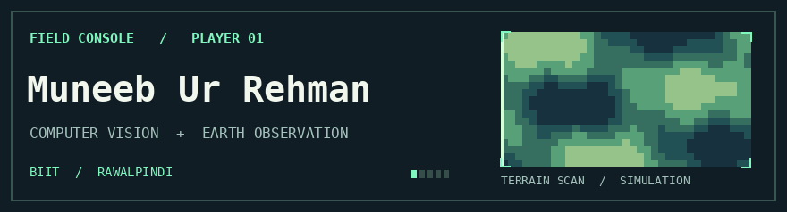

**[LinkedIn ↗ muneeb-ur-rehman-ai](https://www.linkedin.com/in/muneeb-ur-rehman-ai/)**　·　[Email Muneeb](mailto:Mk6821860@gmail.com)

I'm Muneeb, an AI undergraduate at BIIT in Rawalpindi (CGPA **3.96/4.00**). My first attendance model needed a full retrain every time someone joined the class. Fixing that got me interested in what happens after a model leaves the notebook. These days I work with faces, satellite images, and the software that makes their predictions useful.

## ▸ Featured mission · Resilience Nexus

**How much of this satellite patch is forest?** Pick a district, open a Landsat patch, and compare the RGB image with the predicted canopy overlay. The same application lets you adjust a flood alert threshold and see which stations change status.

| Forest segmentation | Coverage | My role |
| --- | --- | --- |
| **64.73% mIoU** on 187 held-out patches | **1,162** patches across **17** districts | Built the forest pipeline, FastAPI backend, interface, and PDF/CSV exports |

I combined ResSE-UNet and LightGBM for the forest masks. My teammate Abdullah contributed the trained flood model.

**[Open Resilience Nexus →](https://github.com/Muneebk06/Resilience-Nexus)**

## ▸ Select a project

| Project | An engineering decision I made |
| --- | --- |
| [BIIT Vision OS](https://github.com/Muneebk06/biit-vision-os) | Replaced the fixed student classifier with MobileNetV2 embeddings. Enrolling someone now adds a face vector. A vote across ten frames stabilizes the attendance decision. |
| [YouTube AI Research Agent](https://github.com/Muneebk06/Youtube-ai-research-Ai-agent) | Repeated transcript requests were eating into the daily token budget. I added caching so follow-up questions can reuse material the agent already retrieved. |
| [Retail Inventory](https://github.com/Muneebk06/CSharp-SQL-Retail-Inventory) | Kept stock updates in SQL Server so the C# desktop app and its reports use the same inventory records. |

**Tools I use**　Python · TensorFlow · OpenCV · LightGBM · FastAPI · LangChain · SQL
